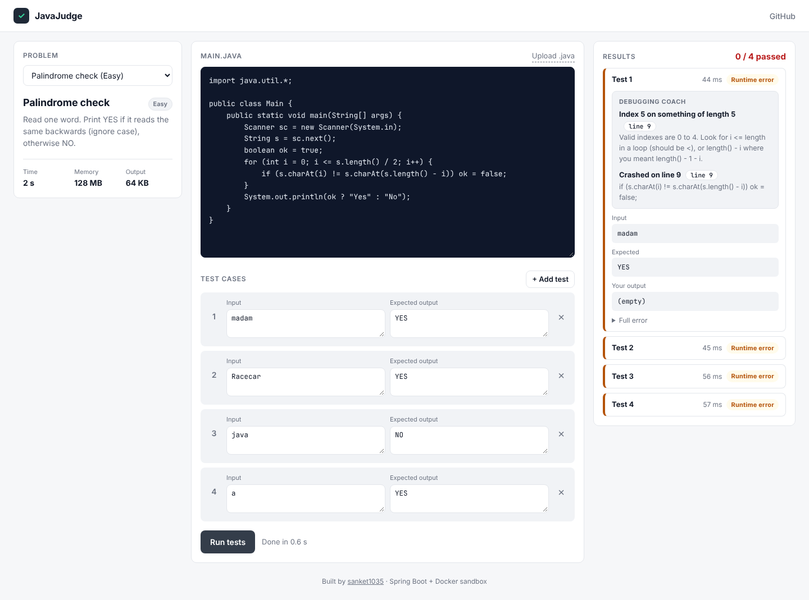

# JavaJudge

A Java code runner with a debugging coach. Paste or upload a Java program, give it test cases, and it compiles and runs each one inside a locked-down Docker container. When a test fails, it doesn't stop at "Wrong answer": it shows the first output line that differs and names the likely bug, with the line in your code.



## What it does

- **Runs Java safely.** Each compile and each test runs in a fresh container with no network, a read-only filesystem, 256 MB memory, 1 CPU, 64 processes, as user `nobody`, killed after 2 seconds.
- **Gives a verdict per test.** Passed, Wrong answer, Runtime error, Time limit exceeded or Output limit exceeded, with input, expected output, your output and the error.
- **Explains the failure.** The debugging coach recognises common mistakes:

| Mistake | How it is detected |
|---|---|
| `int` overflow | Expected value is above 2,147,483,647, or your answer flipped to negative, and the code uses `int` |
| Scanner `nextInt()` then `nextLine()` | Both calls in the code, and the output is wrong or `parseInt("")` fails |
| Off-by-one index | `Index 5 out of bounds for length 5` in the error, with the crash line from the stack trace |
| Infinite loop | Time limit hit, points at the first `while` loop |
| Prompts in output | `"Enter a number:"` style prints, or extra text around the right answer |
| Wrong case or format | `Yes` vs `YES`, or right values with wrong separators |
| Only edge cases fail | Normal tests pass, single-element, zero or negative inputs fail |
| Compile errors | javac errors rewritten in plain English (missing `;`, unknown symbol, lossy conversion, missing return and more) |

Plus null pointers, division by zero, reading past the input, stack overflow, out of memory and changing a list while looping over it.

- **Comes with 10 practice problems** (two sum, palindrome, anagram, rotate array, big factorial and others), each checked by a reference solution in the tests.

## Run it locally

Needs Java 17 or newer.

```bash
./mvnw test              # 59 tests (Docker tests skip if Docker isn't running)
./mvnw spring-boot:run   # http://localhost:8080
```

Windows: `mvnw.cmd` instead of `./mvnw`.

Local mode runs the code directly on your machine, so only run your own code with it. To use the Docker sandbox locally:

```bash
docker pull eclipse-temurin:17-jdk-alpine
./mvnw spring-boot:run -Dspring-boot.run.arguments=--runner.sandbox=DOCKER
```

## API

`POST /api/run` with JSON:

```json
{
  "code": "public class Main { public static void main(String[] a) { System.out.println(5); } }",
  "testCases": [{ "input": "", "expected": "5" }]
}
```

`POST /api/run/upload` with form fields `file` (a `.java` file) and `tests` (the test cases as JSON).

`GET /api/problems` and `GET /api/problems/{id}` list the practice problems.

A failed test in the response looks like this:

```json
{
  "caseNumber": 2,
  "verdict": "WRONG_ANSWER",
  "input": "2000000000 2000000000",
  "expected": "4000000000",
  "actual": "-294967296\n",
  "diff": { "line": 1, "expected": "4000000000", "actual": "-294967296" },
  "hints": [
    { "code": "INT_OVERFLOW", "title": "Number too big for int", "detail": "int stops at 2,147,483,647 ...", "line": 6 }
  ]
}
```

Errors come back as `{"error": "..."}` with status 400 (bad input) or 503 (server busy).

## How it works

```
Browser / API client
      │  code + test cases
      ▼
RunController ──► CodeRunner
                   1. take a run slot (max 2 at once in production)
                   2. new temp folder, save <ClassName>.java
                   3. javac in a container (10 s limit)
                   4. for each test: java in a container, stdin from a file,
                      stdout/stderr to files, timeout inside the container
                   5. OutputComparer: actual vs expected
                   6. DebugCoach: diff + hints for every failed test
                   7. delete the temp folder
      ▼
RunReport (JSON) ──► web page shows green/red tests and hints
```

| Package | What is in it |
|---|---|
| `service` | `CodeRunner` (the pipeline), `CommandBuilder` (local and Docker commands), `OutputComparer`, `RunnerProperties` |
| `coach` | `DebugCoach` (runtime and wrong-answer hints), `CompileErrorExplainer` |
| `problem` | `ProblemCatalog` loads `problems.json` |
| `web` | `RunController`, `ProblemController`, `ApiErrorHandler` |
| `model` | Records for requests, results, hints, and the `Verdict` enum |
| `resources/static` | The web page: plain HTML, CSS and JavaScript |

## Design decisions

- **Output goes to files, not pipes.** A program that prints more than the pipe buffer while nobody reads it blocks forever. Redirecting to files avoids the deadlock without extra threads.
- **Timeout inside the container.** `timeout 2.0 java ...` runs inside the sandbox, so container start-up time doesn't count against the program. A second, longer timer outside force-removes the container if Docker itself hangs.
- **Empty environment.** The child process gets only `PATH`, so submitted code can't read server secrets through `System.getenv()`.
- **At most 64 KB of output is read**, so a print loop can't fill the server's memory.
- **A semaphore caps parallel runs.** Extra submissions wait up to 5 seconds, then get a 503, instead of overloading a small server.
- **Hints are simple rules, not AI.** Each one is a check you can read in `DebugCoach` and explain. They can be wrong, so the UI calls them hints.

## Deploy

See [DEPLOY.md](DEPLOY.md). It needs a Linux server with Docker (a small VM), because every submission starts a container.

## Tech

Java 17, Spring Boot 3.3, ProcessBuilder, Docker, JUnit 5, AssertJ, MockMvc, GitHub Actions. Front end in plain HTML, CSS and JavaScript.

## Author

[sanket1035](https://github.com/sanket1035)
